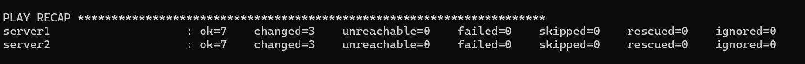

# Laboratorio de Ansible con Docker

**Estudiante:** Oskarling Moises Mendez Mercedes  
**Matrícula:** 2025-1058

## Objetivo

Crear un laboratorio con dos servidores Linux utilizando Docker y administrarlos con Ansible. En esta práctica se comprueba la conexión con los contenedores, se identifica su sistema operativo y se automatiza la creación de archivos y carpetas mediante un playbook.

## Archivos

- `docker-compose.yml`: define los dos servidores Ubuntu 24.04 (`server1` y `server2`).
- `inventory.ini`: indica a Ansible los servidores que va a administrar.
- `playbook.yml`: contiene las tareas que se ejecutan en ambos servidores.
- `README.md`: documenta los pasos y la evidencia de la práctica.

## 1. Iniciar los contenedores

Abrir una terminal en esta carpeta y ejecutar:

```bash
docker compose up -d
docker ps
```

## 2. Instalar Python en ambos servidores

```bash
docker exec server1 bash -c "apt-get update && apt-get install -y python3"
docker exec server2 bash -c "apt-get update && apt-get install -y python3"
```

## 3. Comprobar la conexión y ejecutar el playbook

En una terminal Linux con Ansible, Docker CLI y la colección `community.docker` instalados:

```bash
ansible-galaxy collection install community.docker
ansible docker -i inventory.ini -m ping
ansible-playbook -i inventory.ini playbook.yml
```

**Alternativa para Windows con Docker Desktop, sin instalar Ansible en Windows:** desde PowerShell en esta misma carpeta, se puede usar un contenedor temporal como controlador. Los contenedores `server1` y `server2` deben estar encendidos y tener Python instalado.

```powershell
docker run --rm -v "${PWD}:/work" -v /var/run/docker.sock:/var/run/docker.sock -w /work alpine:3.21 sh -c "apk add --no-cache ansible docker-cli && ansible-galaxy collection install community.docker && ansible docker -i inventory.ini -m ping && ansible-playbook -i inventory.ini playbook.yml"
```

El inventario utiliza `community.docker.docker`, el nombre completo del complemento de conexión de Docker, porque es más compatible con versiones actuales de Ansible que el nombre corto `docker`.

## 4. Comprobar los resultados

El playbook muestra el nombre de cada servidor y su sistema operativo, crea `/tmp/ansible-demo/info.txt`, crea los directorios `logs`, `backup` y `config` mediante un loop y muestra un mensaje cuando el sistema operativo es Ubuntu.

Para revisar los archivos:

```bash
docker exec server1 cat /tmp/ansible-demo/info.txt
docker exec server2 cat /tmp/ansible-demo/info.txt
docker exec server1 ls -la /tmp/ansible-demo
```

## 5. Captura de ejecución

Agregar aquí la captura real de la terminal donde se vea el resultado exitoso del playbook, especialmente las tareas ejecutadas en ambos servidores y el resumen `PLAY RECAP`.



> **Importante:** Tomar la captura después de ejecutar el playbook y guardarla en esta carpeta con el nombre `captura-ejecucion.png` antes de subir el repositorio a GitHub. No se incluye una captura inventada.
